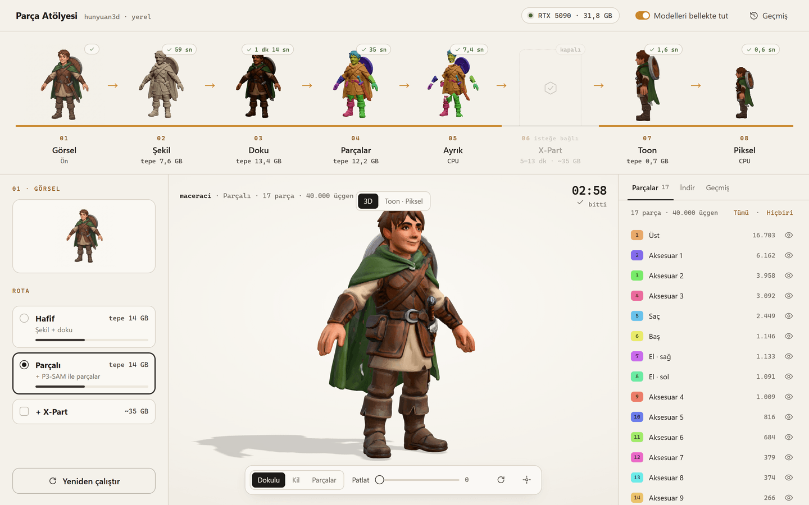
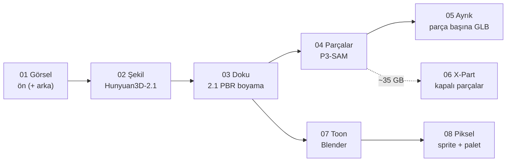
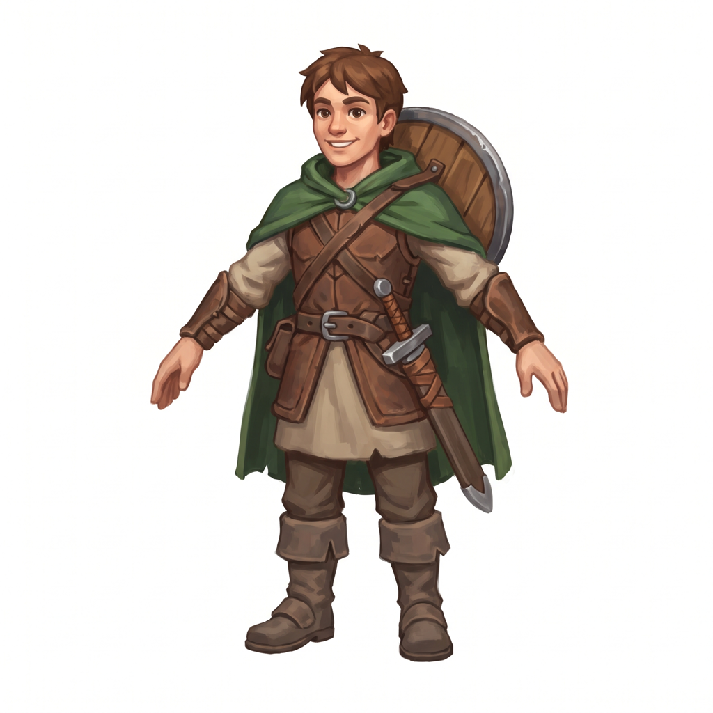
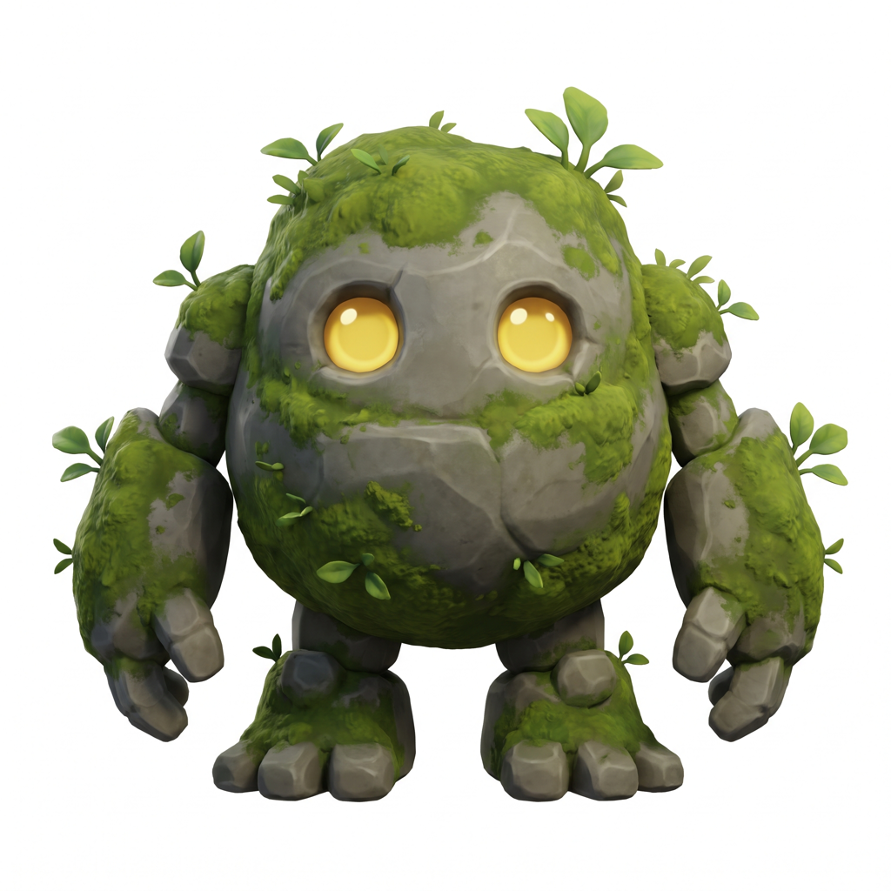
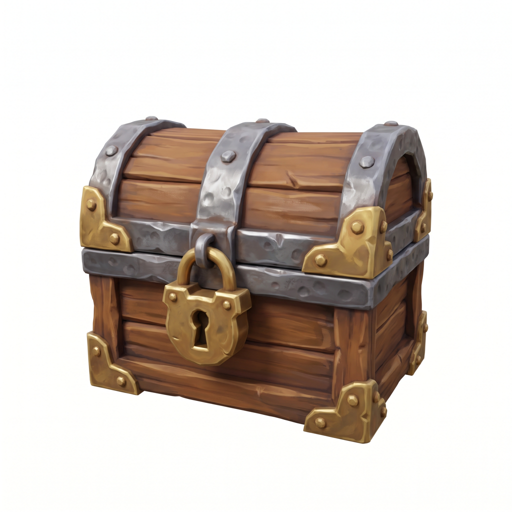
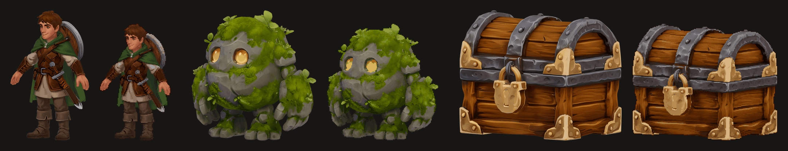

# Parça Atölyesi

**Tek bir görselden oyun varlığı:** 3B mesh, PBR doku, ayrı ayrı parçalar, toon render ve piksel sprite. Hepsi
kendi NVIDIA ekran kartında, tarayıcıdan kullandığın yerel bir panelle.

Bir karakter, yaratık ya da eşya çizimi verirsin. Parça Atölyesi önce
[Hunyuan3D-2.1](https://github.com/Tencent-Hunyuan/Hunyuan3D-2.1) ile 3B şeklini ve dokusunu üretir, istersen
[Hunyuan3D-Part](https://github.com/Tencent-Hunyuan/Hunyuan3D-Part) (P3-SAM) ile parçalara ayırıp her parçayı ayrı
bir GLB olarak verir. Sonra Blender'la cel-shaded bir görsel çizer ve onu istediğin boyda, istediğin paletle
piksel sprite'a çevirir. Bulut yok, hesap yok, kredi yok. Kurulumdan sonra internet de gerekmez.



## Ne üretir?

| Çıktı | Dosya | Nerede işine yarar |
|---|---|---|
| 3B şekil | `shape.glb` | Blender'da düzenleme, heykel, baskı |
| Dokulu 3B model (PBR) | `textured.glb` | Godot, Unity, Unreal, Blender |
| Parça başına ayrı model | `parts/part_XX.glb`, `parts.glb`, `parts.json` | Pelerini kumaş simülasyonuna, kılıcı ayrı bir objeye vermek, parça maskeleri |
| Kapalı parça meshleri (X-Part, ~35 GB) | `xpart/parts.glb` | Gövdeden tamamen ayrılabilen temiz parçalar |
| Toon render (ön, 3/4, yan) | `toon_<açı>.png` | Konsept, kapak, 2B oyun |
| Piksel sprite | `piksel_<boy>.png` | Piksel oyunlar. Boy ve palet seçilebilir |
| Hepsi bir arada | `paket.zip` | |

## Nasıl çalışır?



- **Hafif rota:** 01 → 02 → 03 → 07 → 08. Parçalara ayırma yok. **12–16 GB kartlar için.** 8 GB'lık kartta doku
  kapalı, yalnız şekil.
- **Parçalı rota:** Hafif + 04 → 05. 16 GB ve üstü önerilir.
- **+ X-Part:** ~35 GB ister. Her kartta seçilebilir; daha küçük kartta Windows belleği taşırır, yavaşlar
  (32 GB'lık RTX 5090'da ~13 dakika).

Her adımın ne ürettiği: [docs/adim-adim.md](docs/adim-adim.md).

## Hızlı başlangıç (Windows)

Önce şunlar kurulu olsun: güncel NVIDIA sürücüsü, [Git](https://git-scm.com/download/win),
[CUDA Toolkit 12.x](https://developer.nvidia.com/cuda-downloads), Visual Studio 2022 ("C++ ile masaüstü
geliştirme") ve [Blender 4.2+](https://www.blender.org/download/). Ayrıntılar ve nedenleri:
[docs/kurulum.md](docs/kurulum.md).

```powershell
git clone https://github.com/tercumantanumut/parca-atolyesi.git parca-atolyesi
cd parca-atolyesi
powershell -ExecutionPolicy Bypass -File kurulum\kur.ps1 ayar
notepad atolye.toml
powershell -ExecutionPolicy Bypass -File kurulum\kur.ps1
powershell -ExecutionPolicy Bypass -File baslat.ps1
```


1. `atolye.toml` içinde Blender, CUDA ve Visual Studio yollarını kontrol et (düz eğik çizgiyle: `C:/...`).
2. `kur.ps1` Python ortamını kurar, modelleri indirir (~21 GB zorunlu, hepsiyle ~35 GB) ve hepsini kontrol
   eder. Yarıda kalırsa aynı komutu yeniden çalıştır, kaldığı yerden devam eder. X-Part'ı kullanmayacaksan
   `kur.ps1 hepsi --xpart-yok` ile 9 GB'lık indirmeyi atla.
3. `baslat.ps1` sunucuyu açar. Tarayıcıda **<http://127.0.0.1:8731>** adresine git.
4. `ornekler\maceraci.png` dosyasını panele sürükle, **Parçalı**'yı seç, **Başlat**.

Linux: kurulum betiği şimdilik yalnız Windows için. El ile kurulum notları
[docs/kurulum.md](docs/kurulum.md#linux-notları) içinde.

## Örnek görseller

`ornekler/` klasöründe denemek için üç görsel var:

<p>
  
  
  
</p>

`maceraci.png` → Parçalı (pelerin, kalkan, kılıç ayrı parça olur) · `tas_golem.png` → Hafif ·
`hazine_sandigi.png` → Hafif. Kendi görselin için: [docs/gorsel-ipuclari.md](docs/gorsel-ipuclari.md).



## Ne kadar sürer, ne kadar VRAM ister?

**RTX 5090 (32 GB) ölçümleri**, model yükleme dahil:

| Adım | Süre | Tepe VRAM |
|---|---|---|
| 02 Şekil | ~1 dk | ~8,5 GB |
| 03 Doku | ~1–1,5 dk | ~13,5–14,5 GB |
| 04 Parçalar (P3-SAM) | ~20 sn | ~13 GB |
| 05 Ayrık | birkaç sn | CPU |
| 06 X-Part | ~5–7 dk (40 GB+), ~13 dk (32 GB) | ~35 GB |
| 07 Toon | ~2–3 sn | çok az |
| 08 Piksel | < 1 sn | CPU |

Adımlar sırayla ve ayrı işlemlerde çalışır. Gereken VRAM toplam değil, en ağır adımın tepesidir. Kartında VRAM
yetmezse Windows hata vermek yerine sistem belleğine taşar ve adım çok yavaşlar. Panel bu yüzden çalışamayacak
rotaları kilitler. Ayrıntılar: [docs/rotalar-ve-vram.md](docs/rotalar-ve-vram.md).

## Belgeler

| Sayfa | İçinde |
|---|---|
| [Kurulum](docs/kurulum.md) | Gerekenler, adım adım Windows kurulumu, model grupları, Linux notları |
| [Rotalar ve VRAM](docs/rotalar-ve-vram.md) | Hangi kartta ne çalışır, ölçümler, bellek taşması |
| [Adım adım](docs/adim-adim.md) | Sekiz adımın her biri ne yapar, ne üretir. Komut satırından kullanım |
| [Panel](docs/panel.md) | Arayüzün kullanımı |
| [Görsel ipuçları](docs/gorsel-ipuclari.md) | İyi sonuç veren görsel nasıl hazırlanır |
| [Sorun giderme](docs/sorun-giderme.md) | Sık karşılaşılan sorunlar ve çözümleri |
| [Lisanslar](docs/lisanslar.md) | Kod, modeller ve araçların lisansları, Türkçe özetleriyle |
| [Tek sayfalık rehber](docs/gist.md) ([gist](https://gist.github.com/tercumantanumut/13aef3ce6b35399a35202a9ef936ab08)) | Hepsinin kısa hali, baştan sona |

## Lisanslar: kısaca


- **Bu deponun kodu MIT lisanslı.**
- **Modeller bu depoda yok ve dağıtılmıyor.** Kurulum onları doğrudan yayıncılarından (Hugging Face, GitHub)
  indirir. Her model kendi lisansıyla gelir.
- **Hunyuan3D modelleri** (2.1, Part, 2mv) [Tencent Hunyuan 3D Community License](https://github.com/Tencent-Hunyuan/Hunyuan3D-2.1/blob/main/LICENSE)
  ile gelir. Bu lisans **Avrupa Birliği, Birleşik Krallık ve Güney Kore'de geçerli değil.** Çıktıları bu bölgelerde
  kullanmak ve dağıtmak da kapsam dışında. Başka yapay zekâ modellerini eğitmek yasak. Yayınladığın makine
  üretimi içeriği makine üretimi olarak belirtmen isteniyor. Türkiye bölgenin içinde.
- **Parçalı rota**, Meta'nın Sonata modelini kullanır. Sonata'nın ağırlıkları **CC BY-NC 4.0** (ticari olmayan
  kullanım) lisanslı. Ticari bir oyun için önce lisans sayfasını oku.
- **Blender** GPL lisanslı. Biz yalnız çağırıyoruz, Blender'ı dağıtmıyoruz.

Türkçe özetler ve bütün bağlantılar: [docs/lisanslar.md](docs/lisanslar.md). Buradaki özetler hukuki tavsiye
değildir.

## Teşekkürler

Bu proje başkalarının açık çalışmaları üzerine kurulu: Tencent Hunyuan ekibinin
[Hunyuan3D-2.1](https://github.com/Tencent-Hunyuan/Hunyuan3D-2.1),
[Hunyuan3D-2](https://github.com/Tencent-Hunyuan/Hunyuan3D-2) ve
[Hunyuan3D-Part](https://github.com/Tencent-Hunyuan/Hunyuan3D-Part) modelleri; Meta'nın
[DINOv2](https://github.com/facebookresearch/dinov2) ve [Sonata](https://github.com/facebookresearch/sonata)
modelleri; [Real-ESRGAN](https://github.com/xinntao/Real-ESRGAN), [rembg](https://github.com/danielgatis/rembg),
[Blender](https://www.blender.org/) ve [three.js](https://threejs.org/). Parça Atölyesi Tencent ya da Meta ile
bağlantılı değildir; onlar tarafından desteklenmez ya da onaylanmaz.
