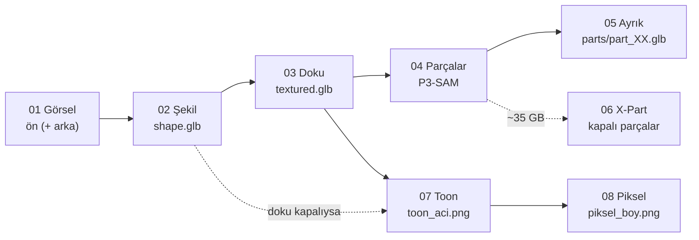
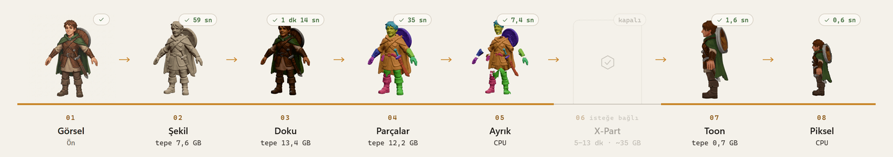

# Adım adım: sekiz adım, her biri ne üretir?

Panelin üstündeki şerit 01'den 08'e kadar sekiz adımı gösterir. Bu sayfa her adımın ne yaptığını, hangi dosyayı
ürettiğini ve ne kadar sürdüğünü anlatır. Süreler ve VRAM değerleri **RTX 5090 ölçümü.**



Hafif rota 04, 05 ve 06'yı atlar. Doku kapalıysa 03 atlanır. Her işin bütün dosyaları
`cikti\<iş-kimliği>\` klasörüne yazılır. Panelin **İndir** sekmesi de aynı dosyaları verir.



---

## 01 · Görsel

**Ne yapar:** Görselini alır. Arka planı temizler, nesneyi kırpıp kare ve şeffaf bir tuvalin ortasına koyar.
Şekil modeli böyle bir girdi bekliyor.

- **Girdi:** PNG, JPG ya da WEBP. En az 64 × 64 piksel. İsteğe bağlı ikinci bir **arka** görsel.
- **Arka plan nasıl temizlenir?** Kendiliğinden seçilir:
  - Görselin zaten şeffaf arka planı varsa olduğu gibi kullanılır.
  - Kenarlar düz ve açık renkse (beyaz, açık gri) kenardan içeri doğru **doldurma** yapılır. Beyaz
    kıyafetleri korur.
  - Diğer her durumda **rembg (U²-Net)** ile kesilir.
- **Üretir:** `girdi_on.png` (yüklediğin görsel), `input_rgba.png` (modelin gördüğü kesilmiş hali; doku adımı da
  bunu kullanır). Arka görsel verdiysen `girdi_arka.png` ve `input_back_rgba.png`.
- **Hazır mesh:** görsel yerine GLB, OBJ, PLY ya da STL de bırakabilirsin. O zaman 02 Şekil atlanır. Mesh glTF
  eksenlerinde olmalı: Y yukarı, ön yüz +Z.

İyi bir girdi nasıl olur: [gorsel-ipuclari.md](gorsel-ipuclari.md).

## 02 · Şekil

**Ne yapar:** Hunyuan3D-2.1 tek görselden dokusuz bir 3B mesh üretir. Arka görsel verdiysen (ve 2mv kuruluysa)
Hunyuan3D-2mv iki görselden üretir.

- **Üretir:** `shape.glb`. Y yukarı, ön +Z, görsele göre yarım milyon ile bir milyon arası yüz. Ayrıca `sekil.json` (süre, VRAM, yüz
  sayısı, arka plan yöntemi).
- **Süre / VRAM:** ~20 sn model yükleme + ~34 sn üretim, tepe 8,2–8,5 GB.
- **Tohum:** aynı görsel ve aynı tohum aynı sonucu verir. Şekil kötü çıktıysa paneldeki zar düğmesiyle yeni
  bir tohum dene. Detaya değil, siluete bakarak seç. Genelde 1–5 farklı tohumdan biri iyi çıkar.

## 03 · Doku

**Ne yapar:** Hunyuan3D-2.1'in PBR boyama modeli mesh'i boyar. Önce mesh'i ~40 bin yüze sadeleştirip UV açar,
sonra 6 açıdan görünüm üretip bunları senin görseline göre boyar. Boyanmış görünümleri Real-ESRGAN ile büyütür ve
tek bir doku atlasına işler. Görünmeyen boşlukları da doldurur.

- **Üretir:** `textured.glb`, glTF PBR malzemesiyle: renk (albedo) + metalik/pürüzlülük, 2048 × 2048 doku,
  dokular dosyanın içine gömülü. Ayrıca `doku.json`.
- **Süre / VRAM:** ~13–22 sn yükleme + ~40–60 sn boyama. Gerçekten kullanılan bellek **~13,5–14,5 GB**, rotanın
  en ağır adımı. 32 GB'lık kartta PyTorch boş yer bulunca daha fazlasını ayırır, panelde "tepe 20 GB" görmen
  normal.
- **Bilmekte fayda var:** doku yalnız ön görselden boyanır, görünmeyen yüzleri model tahmin eder. Arka görsel
  yalnız şekli etkiler.
- 14 GB'tan küçük kartlarda panel bu adımı kapalı getirir. Bkz. [rotalar-ve-vram.md](rotalar-ve-vram.md).

## 04 · Parçalar (yalnız Parçalı rota)

**Ne yapar:** P3-SAM (Hunyuan3D-Part) mesh'i anlamlı parçalara ayırır: saç, kafa, gövde, kollar, pelerin,
kalkan, kılıç gibi. Bu adım yalnız etiketler, mesh'i henüz bölmez.

- **Üretir:** `p3sam\auto_mask_mesh_final.glb` (her parçası ayrı renge boyanmış mesh), parça kimlikleri ve
  kutuları (`*_face_ids.npy`, `*_aabb.npy`), `p3sam\p3sam.json`.
- **Süre / VRAM:** ~2 sn yükleme + 16–24 sn, tepe 13,1 GB.
- **Bilmekte fayda var:** P3-SAM renge değil **geometriye** bakar. Aynı yüzeyde birleşik duran iki farklı
  renkli giysi tek parça çıkabilir. Parçalar uzuvlara değil giysilere ve aksesuarlara göre ayrılır. Ayrıntı
  meshten meshe değişir: yüz bazen saçla, bazen kafayla gider.

## 05 · Ayrık (yalnız Parçalı rota)

**Ne yapar:** 04'ün etiketlerini kullanıp **dokulu** mesh'i her parça için ayrı bir GLB'ye böler. Her parça
UV'sini ve dokusunu korur. CPU'da çalışır.

- **Üretir:**
  - `parts\part_XX.glb`: her parça ayrı dosya. `00` en büyük parça. Her biri kendi maskelenmiş doku kopyasını
    taşır, oyun motoruna tek tek alabilirsin.
  - `parts.glb`: bütün parçalar tek sahnede, her parça ayrı düğüm (`part_XX_<tahmin>`).
  - `parts.json`: her parçanın yüz sayısı, kutusu, merkezi, panelde gösterilen rengi ve kaba bir **tahmini**
    (`hair`, `head`, `top`, `legs`, `hand.L`, `hand.R`, `foot.L`, `foot.R`, `accessory`).
- **Süre:** birkaç saniye.
- **Tahminler yalnız ipucu.** Ayakta duran insansı bir karakter varsayan basit kutu kurallarıyla verilir.
  Yaratıklarda ve eşyalarda çoğu parça `accessory` çıkar. Parçalara bakıp kendi adlarını kendin ver.

## 06 · X-Part (isteğe bağlı, ~35 GB)

**Ne yapar:** Her parçayı **kapalı, kendi başına duran** bir mesh olarak baştan üretir. Gövdenin arkasında
kalan, görünmeyen yüzeyleri de kapatır. Önce P3-SAM'i küçük parçaları birleştiren ayarla yeniden çalıştırır,
sonra X-Part'ı.

- **Üretir:** `xpart\parts.glb` (kapalı parçalar), `xpart\parts_explode.glb` (patlatılmış görünüm),
  `xpart\bbox.glb` (parça kutuları), `xpart\parts\part_XX.glb`, `xpart\xpart.json` (her parçanın kapalı olup
  olmadığı dahil).
- **Süre / VRAM:** tepe ~35 GB (octree 384). 40 GB ve üstü kartta ~5–7 dk. Daha küçük kartta da çalışır: panel
  uyarır ve onay ister, Windows belleği paylaşılan sistem belleğine taşırır, adım yavaşlar. RTX 5090'da (32 GB) ölçtük: P3-SAM ön çalışması 43 sn + yükleme 31 sn + üretim 710 sn, toplam ~13 dakika, tepe 35,4 GB.
- **Bilmekte fayda var:** parçalar yeni geometri, **UV'leri ve dokuları yok.** Büyük parçalar (pelerin, ceket,
  pantolon) iyi çıkar, küçük parçalar biraz yumrulu olabilir. Bu, X-Part'ın herkese açık hafif sürümü.

## 07 · Toon

**Ne yapar:** Blender'ı arka planda (pencere açmadan) çağırır ve modelin **cel-shaded (toon)** bir görselini
şeffaf arka planla çizer. Dokulu mesh varsa onu, yoksa şekli kil renginde kullanır.

- **Açı:** `Ön`, `3/4` (varsayılan) ya da `Yan` (ekranın sağına bakan profil). Kamera ortografik, hafif
  yukarıdan.
- **Görünüm:** sıcak bir ana ışıktan üç ton, arkadan serin bir kenar ışığı, ince bir dış çizgi. Işık bantları
  küçük kıvrımlara değil büyük formlara uyar.
- **Üretir:** `toon_on.png`, `toon_ucceyrek.png` ya da `toon_yan.png` (1024 × 1024, şeffaf).
- **Süre:** ~2–3 sn (Blender'ın açılışı dahil).
- **İş bittikten sonra** paneldeki **Toon · Piksel** sekmesinden açıyı değiştirip yeniden çizdirebilirsin. GPU
  adımları tekrar çalışmaz.
- Blender bulunamazsa 07 ve 08 kilitli görünür ve iş onları "atlandı · Blender bulunamadı" diye geçer; meshler
  yine üretilir. Yolu `atolye.toml` içinde `blender = "..."` satırına yaz, sunucuyu yeniden başlat.

## 08 · Piksel

**Ne yapar:** Toon görselini istediğin boyda bir **piksel sprite**'a çevirir. Nesneyi verdiğin yüksekliğe
ölçekler, ayakları altta olacak şekilde sabit bir ızgaraya oturtur, her bloğun rengini seçer, paletteki en
yakın renge yuvarlar, tek piksellik lekeleri temizler ve 1 piksellik seçici bir dış çizgi ekler.

- **Boy:** nesnenin piksel cinsinden yüksekliği: `160`, `128`, `80` ya da 16–512 arası istediğin bir sayı.
  Tuval nesneden biraz büyüktür (örneğin 160 boy için 256 × 256).
- **Palet:**
  - **Görselden:** `Özgün` (64 renk), `Özgün 32`, `Özgün 16`. Renkler toon görselinin kendisinden seçilir.
  - **Hazır:** `paletler\` klasöründeki `.hex` dosyaları: `endesga-32`, `pico-8`, `sweetie-16`,
    `gameboy-4`. Kendi paletini eklemek için o klasöre her satırda bir `RRGGBB` olan bir `.hex` dosyası koyman
    yeterli. Sunucuyu yeniden başlatınca listede görünür.
- **Üretir:** `piksel_<boy>.png`, örneğin `piksel_160.png` (şeffaf PNG).
- **Süre:** bir saniyeden kısa, CPU.
- İş bittikten sonra boy ve paleti panelden değiştirip anında yeniden üretebilirsin.

---

## Hepsi bir arada: `paket.zip`

İş bitince `cikti\<iş-kimliği>\paket.zip` oluşur. İçinde saklamaya değer her şey var: meshler, parçalar, X-Part
parçaları, toon görselleri, sprite'lar ve json dosyaları. Ara dosyalar (P3-SAM'in maskeleri gibi) içinde yok.
Panelde **İndir → ZIP** ile alırsın.

## Oyun motoruna almak

- **GLB** dosyalarını Godot, Unity (glTFast ya da UnityGLTF ile), Unreal (glTF eklentisiyle) ve Blender doğrudan
  açar. Hunyuan meshleri Y yukarı ve ön yüz +Z, yani glTF'in kendi ekseninde. Blender'a alınca Z yukarı ve -Y'ye
  bakar.
- **Yüz sayısı yüksek:** `shape.glb` yüz binlerce yüz içerir. `textured.glb` ~40 bin yüze sadeleştirilmiştir.
  Oyunda kullanmadan önce gerekirse Blender'da Decimate ile daha da azalt.
- **Sprite'lar** şeffaf PNG. Ayakları hep aynı satırda olduğu için farklı açılardan üretilen sprite'lar üst
  üste oturur.

## İleri seviye: adımları komut satırından çalıştırmak

Her adım tek başına da çalışır. Panelin yaptığı da tam olarak bu. Depo kökünden:

```powershell
$PY = ".atolye\venv\Scripts\python.exe"
& $PY -I atolye\calis.py sekil  --on gorsel.png --cikti cikti\deneme --tohum 3
& $PY -I atolye\calis.py doku   --gorsel cikti\deneme\input_rgba.png --mesh cikti\deneme\shape.glb --cikti cikti\deneme
& $PY -I atolye\calis.py parcalar --mesh cikti\deneme\shape.glb --cikti cikti\deneme\p3sam --birlestir
& $PY -I atolye\calis.py ayrik  --p3sam cikti\deneme\p3sam --hedef cikti\deneme\textured.glb --cikti cikti\deneme
& $PY -I atolye\calis.py toon   --girdi cikti\deneme\textured.glb --cikti cikti\deneme\toon_yan.png --aci yan
& $PY -I atolye\calis.py piksel --girdi cikti\deneme\toon_yan.png --cikti cikti\deneme\piksel_96.png --boy 96 --palet pico-8
```

Panelde olmayan iki ayar burada var:

- `parcalar --birlestir`: küçük parçaları birleştirir, daha az ama daha büyük parça verir. `--tohum` ile
  parçalama biraz değişir.
- `piksel --no-cizgi`: dış çizgiyi kapatır.

Komut satırından çalıştırdığın işler panelin Geçmiş'inde görünmez.
