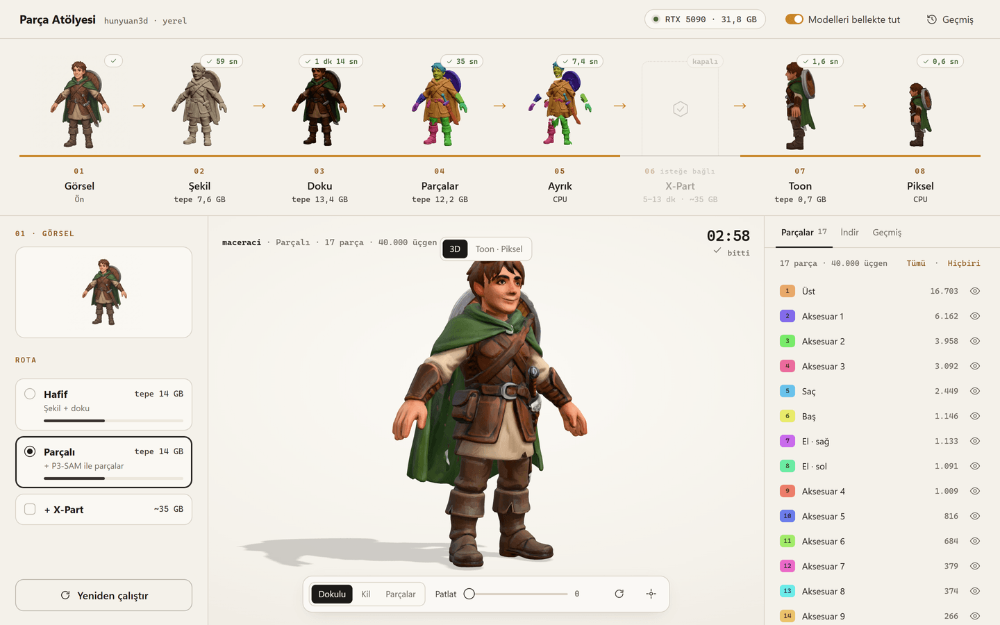
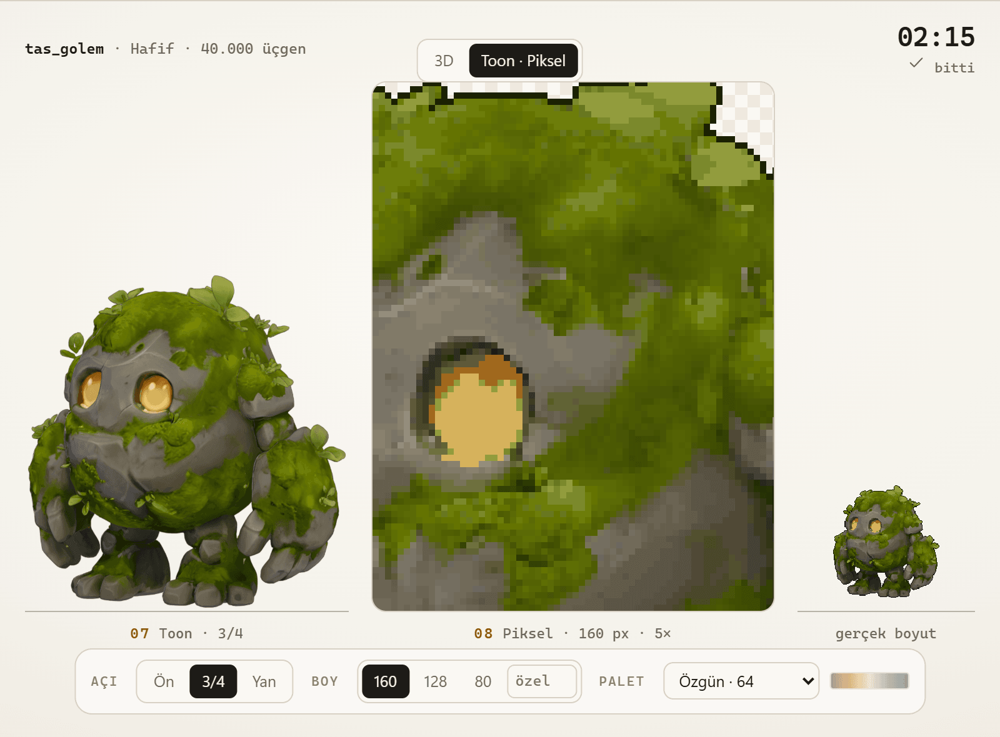

# Parça Atölyesi: tek görselden 3B model, parçalar ve piksel sprite (kendi ekran kartında)

Bir çizim verirsin, şunları alırsın: dokulu bir 3B model (GLB), istersen ayrı ayrı parçaları (pelerin, kalkan,
kılıç…), cel-shaded bir render ve istediğin boyda bir piksel sprite. Her şey kendi NVIDIA kartında, tarayıcıda
açılan yerel bir panelden çalışır. Bu sayfa baştan sona kısa rehber. Ayrıntılar deponun `docs/` klasöründe.

**Depo:** [github.com/tercumantanumut/parca-atolyesi](https://github.com/tercumantanumut/parca-atolyesi)




## Akış

```
görsel ─► 02 Şekil ─► 03 Doku ─► 04 Parçalar ─► 05 Ayrık ─► parça başına GLB
 (01)    Hunyuan3D-2.1  PBR       P3-SAM          │
                        │                         └─► 06 X-Part (~35 GB)    
                        └─► 07 Toon (Blender) ─► 08 Piksel sprite
```

- **Hafif** (01 → 02 → 03 → 07 → 08): parça yok. 12–16 GB kartlar için. 8 GB'ta doku kapalı, yalnız şekil.
- **Parçalı** (Hafif + 04 → 05): parça başına GLB. 16 GB ve üstü önerilir.
- **+ X-Part:** kapalı, temiz parça meshleri. ~35 GB ister; daha küçük kartta da çalışır ama yavaşlar (32 GB'ta ~13 dk).

## 1. Gerekenler

- NVIDIA ekran kartı (en az 8 GB VRAM) ve güncel sürücü (CUDA 12.8 destekli, R570+)
- Windows 10/11 (kurulum betiği şimdilik Windows için, Linux notları depoda)
- [Git](https://git-scm.com/download/win)
- [CUDA Toolkit 12.x](https://developer.nvidia.com/cuda-downloads) (12.6 ya da 12.8)
- Visual Studio 2022 ya da Build Tools, **"C++ ile masaüstü geliştirme"** iş yüküyle
- [Blender 4.2+](https://www.blender.org/download/) (toon ve piksel adımları için)
- ~60 GB boş disk (modeller zorunlu ~21 GB, hepsiyle ~35 GB)

Python gerekmez. Betik kendi Python 3.12'sini [uv](https://docs.astral.sh/uv/) ile getirir.

## 2. İndir ve ayarla

PowerShell'de:

```powershell
git clone https://github.com/tercumantanumut/parca-atolyesi.git parca-atolyesi
cd parca-atolyesi
powershell -ExecutionPolicy Bypass -File kurulum\kur.ps1 ayar
notepad atolye.toml
```

`atolye.toml` içinde üç yolu kontrol et. Yollarda **düz eğik çizgi** kullan:

```toml
[yollar]
blender = "C:/Program Files/Blender Foundation/Blender 4.2/blender.exe"

[kurulum]
cuda = "C:/Program Files/NVIDIA GPU Computing Toolkit/CUDA/v12.6"
vsvars = "C:/Program Files/Microsoft Visual Studio/2022/Community/VC/Auxiliary/Build/vcvars64.bat"
```

Yalnız Build Tools kurduysan `vsvars` genelde
`C:/Program Files (x86)/Microsoft Visual Studio/2022/BuildTools/VC/Auxiliary/Build/vcvars64.bat` olur.

## 3. Kur

```powershell
powershell -ExecutionPolicy Bypass -File kurulum\kur.ps1
```

Modeller arka planda iner. Bu sırada Python ortamı kurulur, Hunyuan kodu sabit bir sürümden çekilir ve iki
küçük eklenti derlenir. Sonunda her dosya kontrol edilir ve `DOĞRULAMA: TAMAM` yazar. İnternet hızına göre
birkaç saat sürebilir (saniyede 5 MB ile ~35 GB yaklaşık 2 saat).

- **Yarıda kaldıysa:** aynı komutu yeniden çalıştır, kaldığı yerden devam eder.
- **X-Part'ı kullanmayacaksan** indirme (9 GB tasarruf):
  `powershell -ExecutionPolicy Bypass -File kurulum\kur.ps1 hepsi --xpart-yok`
- Kayıt: `.atolye\kayit\kurulum.log`

## 4. Başlat

```powershell
powershell -ExecutionPolicy Bypass -File baslat.ps1
```

Tarayıcıda **<http://127.0.0.1:8731>** adresini aç. Durdurmak için pencerede Ctrl+C.

## 5. İlk model

1. `ornekler\maceraci.png` dosyasını sol üstteki alana sürükle.
2. **Parçalı** rotayı seç (küçük kartta **Hafif**).
3. **Başlat** (Ctrl+Enter).
4. Şerit 01'den 08'e dolar. RTX 5090'da Parçalı rota ~3 dakika sürer.
5. Bitince ortada modeli döndür. **Dokulu · Kil · Parçalar** arasında geç, **Patlat** ile parçaları aç.
6. **Toon · Piksel** sekmesinde açıyı (Ön · 3/4 · Yan), boyu (160 · 128 · 80 · özel) ve paleti değiştir. GPU
   adımları tekrar çalışmaz, birkaç saniyede yenilenir.
7. Sağda **İndir → paket.zip**. Aynı dosyalar diskte `cikti\<iş-kimliği>\` klasöründe de durur.



## Ne çıkar?

| Dosya | Ne |
|---|---|
| `shape.glb` | Dokusuz 3B şekil (Y yukarı, ön +Z) |
| `textured.glb` | PBR dokulu model, ~40 bin yüz, 2048² doku içine gömülü |
| `parts/part_XX.glb`, `parts.glb`, `parts.json` | Parça başına model (dokusuyla), hepsi bir arada, parça bilgileri |
| `xpart/parts.glb` | Kapalı parça meshleri (dokusuz) |
| `toon_on.png`, `toon_ucceyrek.png`, `toon_yan.png` | 1024² cel-shaded render, şeffaf arka plan |
| `piksel_<boy>.png` | Piksel sprite, şeffaf |
| `paket.zip` | Hepsi |

## Süre ve VRAM (RTX 5090 ölçümleri)

| Adım | Süre (yükleme dahil) | Tepe VRAM |
|---|---|---|
| 02 Şekil | ~1 dk | ~8,5 GB |
| 03 Doku | ~1–1,5 dk | ~13,5–14,5 GB kullanılan |
| 04 Parçalar | ~20 sn | ~13 GB |
| 06 X-Part | ~5–7 dk (40 GB+), ~13 dk (32 GB) | ~35 GB |
| 07 Toon | ~2–3 sn | çok az |
| 08 Piksel | < 1 sn | CPU |

Adımlar sırayla, ayrı işlemlerde çalışır. Gereken VRAM en ağır adımın tepesi kadardır. **VRAM yetmezse
Windows hata vermez, sistem belleğine taşar ve adım 20–50 kat yavaşlar.** Bir adım dakikalardır sürüyorsa
GPU kullanan diğer uygulamaları kapat, Doku'yu kapat ya da Hafif'e geç.

## İyi sonuç için görsel

- Tek nesne, tamamı kadrajda.
- Düz beyaz ya da açık gri arka plan, ya da şeffaf PNG.
- Yumuşak, eşit ışık. Sert gölge ve parlama dokuya da geçer.
- Karakterde A-pozu: kollar gövdeden, bacaklar birbirinden ayrı. Tam önden.
- Eşyalarda 3/4 açı iyi çalışır.
- Parçalar renge değil şekle göre ayrılır. Pelerin, kalkan, kılıç gibi ayrı duran şekiller iyi ayrılır.
- Şekil kötü çıktıysa önce **tohumu** değiştir (paneldeki zar).

## Sık sorunlar

| Sorun | Çözüm |
|---|---|
| Betik çalışmıyor ("running scripts is disabled") | Komutları `powershell -ExecutionPolicy Bypass -File ...` ile çalıştır |
| "Visual Studio C++ ortamı bulunamadı" | `atolye.toml` → `vsvars` yolunu düzelt, `kur.ps1 ortam` |
| Eklenti derlenmiyor | `atolye.toml` → `cuda` yolu, `.atolye\kayit\kurulum.log` |
| "özet tutmadı" | `.bozuk` dosyasını sil, indirmeyi yeniden çalıştır |
| Panelde "Sunucu yok" | `baslat.ps1` penceresi açık mı? |
| "… modeli indirilmemiş" | `kur.ps1 indir` |
| 07 Toon "Blender yok" | `atolye.toml` → `blender` yolu, sunucuyu yeniden başlat |
| Kol ya da beyaz giysi kesilmiş | Arka planı düz açık renk yap ya da şeffaf PNG ver |

## Lisanslar

- **Parça Atölyesi'nin kodu: MIT.**
- **Modeller dağıtılmıyor.** Kurulum onları doğrudan Hugging Face ve GitHub'dan indirir. Her biri kendi
  lisansıyla gelir.
- **Hunyuan3D 2.1 / Part / 2mv: Tencent Hunyuan 3D Community License**
  ([metin](https://github.com/Tencent-Hunyuan/Hunyuan3D-2.1/blob/main/LICENSE)). Özetle:
  - **Avrupa Birliği, Birleşik Krallık ve Güney Kore'de geçerli değil.** Modelleri ve çıktılarını bu bölgelerde
    kullanmak, dağıtmak ya da göstermek lisansın kapsamında değil. Türkiye bölgenin içinde.
  - Çıktılar üzerinde Tencent hak iddia etmez, sorumluluk sende.
  - Modelleri ya da çıktılarını başka bir yapay zekâ modelini eğitmek için kullanamazsın.
  - Aylık 1 milyonun üstünde aktif kullanıcısı olan şirketler ayrı lisans almalı.
  - Kabul edilebilir kullanım kuralları var: yasa dışı kullanım, zarar, taciz, askerî kullanım yasak. Herkese
    açık yayınladığın makine üretimi içeriği makine üretimi olarak belirtmelisin.
- **Parçalı rota**, Meta'nın **Sonata** modelini kullanır. Ağırlıkları **CC BY-NC 4.0** (ticari olmayan). Ticari
  bir projede parçaları kullanmadan önce bunu değerlendir. Hafif rota Sonata'yı kullanmaz.
- **Blender (GPL):** yalnız çağırıyoruz, dağıtmıyoruz.

Bunlar özet, hukuki tavsiye değil. Bağlayıcı olan özgün lisans metinleri.

Parça Atölyesi Tencent ya da Meta ile bağlantılı değildir; onlar tarafından desteklenmez ya da onaylanmaz.
