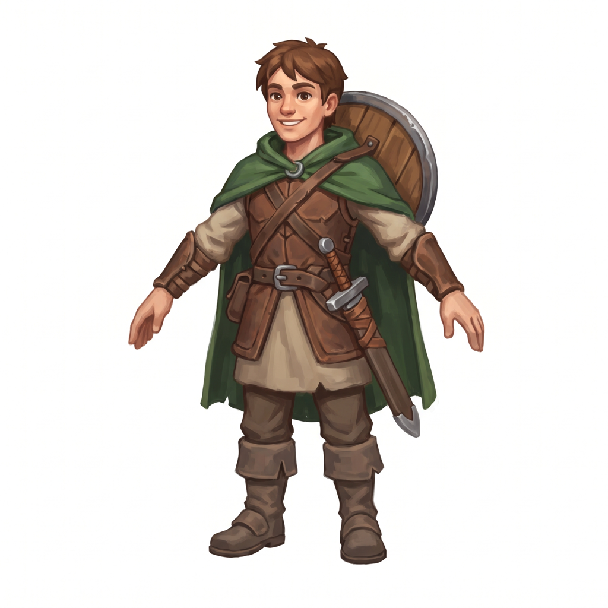
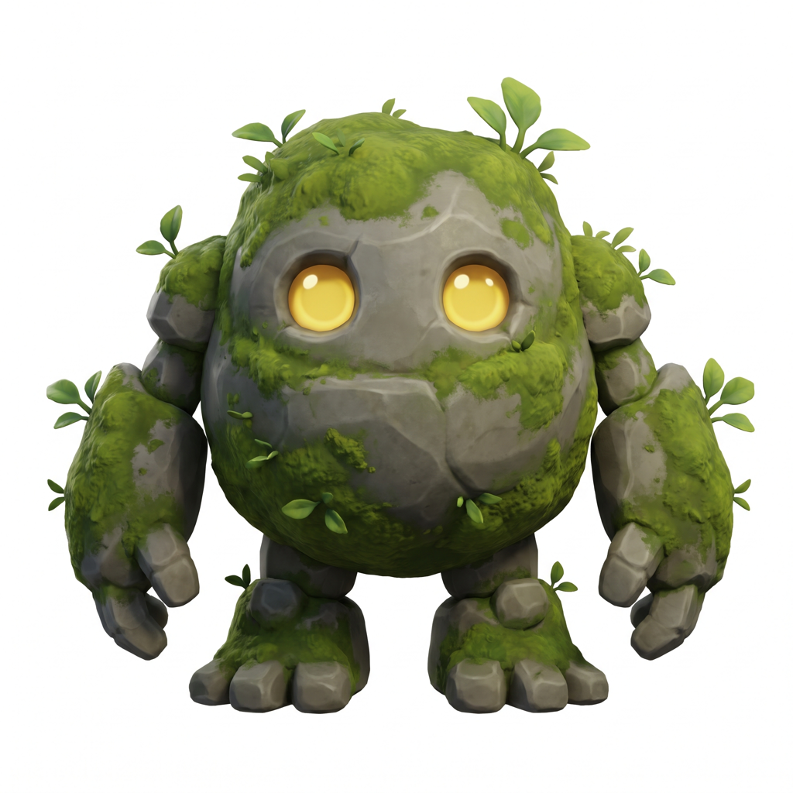
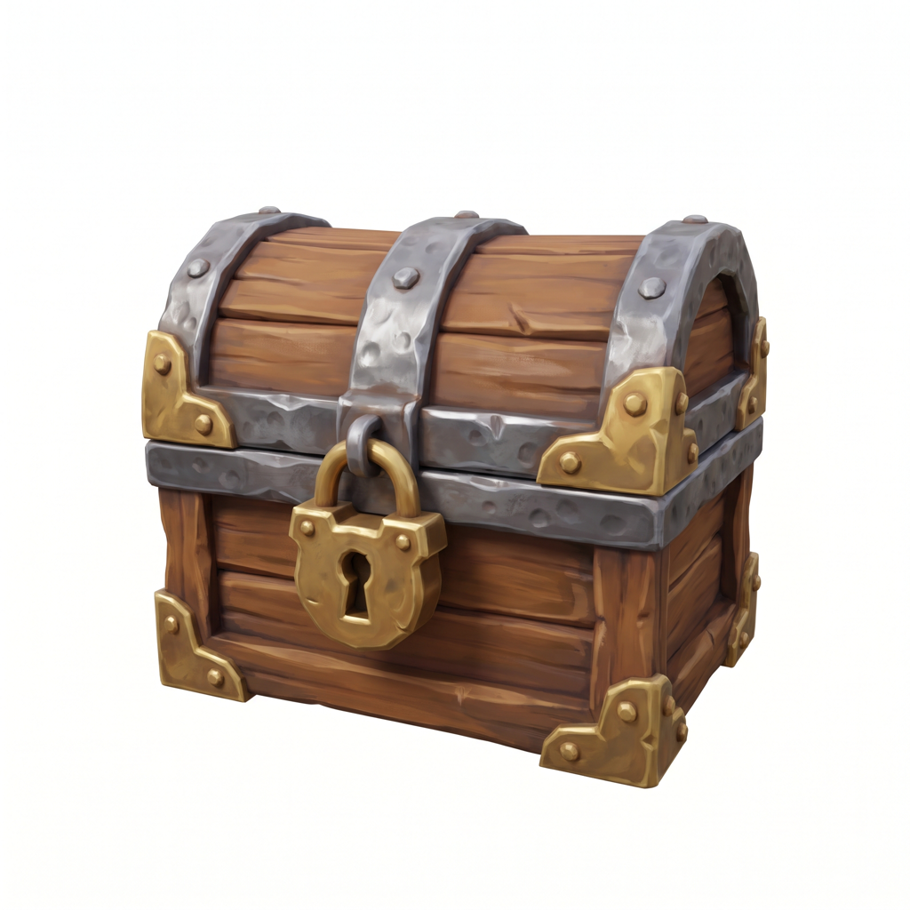

# İyi sonuç için görsel ipuçları

Sonucun kalitesini en çok girdi görseli belirler. Model tek bir görselden, görmediği yüzleri de tahmin ederek
3B bir nesne çıkarıyor. Görsel ona ne kadar net bilgi verirse sonuç o kadar iyi olur.

`ornekler/` klasöründeki üç görsel bu ipuçlarına göre hazırlandı. Kendi görselini hazırlarken onlara bakabilirsin:

  
  
  

| Görsel | Neden iyi | Rota |
|---|---|---|
| `maceraci.png` | A-pozu, kollar gövdeden ayrı, pelerin, kalkan ve kılıç belirgin şekiller | Parçalı |
| `tas_golem.png` | Önden, net bir siluet, tek nesne | Hafif |
| `hazine_sandigi.png` | Eşya, 3/4 açıdan: üst, ön ve yan aynı anda görünüyor | Hafif |

## Kısa liste

- ✅ **Tek nesne,** tamamı kadrajda: ayaklar, kulaklar, silahın ucu kesilmemiş.
- ✅ **Düz, açık renkli arka plan** (beyaz ya da açık gri) ya da **şeffaf PNG.**
- ✅ **Yumuşak, eşit ışık.** Sert gölge ve parlama yok.
- ✅ **Karakterlerde A-pozu ya da T-pozu:** kollar gövdeden, bacaklar birbirinden ayrı.
- ✅ **Net siluet** ve okunaklı büyük şekiller.
- ✅ Nesne görselin büyük kısmını kaplasın. 1024 × 1024 civarı ideal.
- ❌ Desenli ya da renk geçişli arka plan, zemin, yere düşen gölge.
- ❌ Birden fazla karakter, yazı, çerçeve, imza.
- ❌ Güçlü perspektif (balık gözü, aşağıdan bakış).
- ❌ Kolları gövdeye yapışık, elleri cepte, bacakları çapraz poz.
- ❌ Cam, su, duman gibi saydam ya da yarı saydam malzemeler.

## Arka plan

01 Görsel adımı arka planı kendisi temizler, ama yolu görsele göre seçer:

1. **Şeffaf PNG:** olduğu gibi kullanılır. En güvenilir yol.
2. **Kenarları düz ve açık renk** (beyaz, açık gri): kenardan içeri doğru doldurma yapılır. Beyaz kıyafetler bu
   yolla korunur, yeter ki nesnenin bir dış çizgisi ya da arka plandan ayrılan bir kenarı olsun.
3. **Diğer her şey:** yapay zekâ ile kesilir (rembg, U²-Net). İşe yarar, ama beyaz ya da açık renk giysileri
   arka planla birlikte yiyebilir.

Kesilmiş hali `cikti\<iş>\input_rgba.png` dosyasında görebilirsin. Şekil tuhaf çıktıysa ilk bakılacak yer burası:
bir kol ya da etek kesilmişse sorun modelde değil, arka planda.

## Işık ve gölge

Doku adımı görselindeki renkleri **olduğu gibi** dokuya taşır: yüzdeki sert gölge, metaldeki parlama da dokuya
"boyanır." Toon adımı sonra kendi ışığını ekler. Görselde zaten güçlü ışık varsa sonuç çift gölgeli ve kirli
görünür. **Düz, eşit, yumuşak ışıklı** görseller en temiz toon ve piksel sonucunu verir.

## Açı

- **Karakter ve yaratık:** tam önden, göz hizasından.
- **Eşya (sandık, sandalye, varil):** 3/4 açıdan, hafif yukarıdan da olur. Model üst, ön ve yanı aynı anda
  görünce hacmi daha iyi kurar (`hazine_sandigi.png` gibi).
- **Arkası önemli bir karakter:** arkadan çizimini de **+ arka** ile ver. Şekil iki görselden üretilir. Doku yine
  ön görselden boyanır.

## Parçalı rota için

P3-SAM parçaları **geometriye** göre ayırır, renge göre değil:

- Pelerin, kalkan, kılıç, şapka, çanta gibi **gövdeden ayrı duran şekiller** iyi ayrılır.
- Yalnız rengi farklı olan şeyler (desen, tişört üzerine yelek baskısı) genelde tek parça kalır.
- Gövdeye yapışık küçük aksesuarlar (kemer tokası, küçük kolye) çoğu zaman ayrı parça çıkmaz.
- Kollar ve bacaklar her zaman ayrı parça olmaz. Parçalar uzuvlardan çok giysileri izler.

## Piksel sprite için

- Küçük boylarda (80 piksel ve altı) **ince ayrıntılar kaybolur:** tek tek saç telleri, zincirler, ince parmaklar.
  Hedef boyun küçükse kalın hatlı, iri formlu karakterler daha iyi okunur.
- Renk sayısı az olan bir palet (`pico-8`, `sweetie-16`, `gameboy-4`) retro bir görünüm verir. `Özgün` paletler
  görselindeki renklere en yakın sonucu verir.

## Model neyi iyi, neyi kötü yapar?

| İyi | Zor |
|---|---|
| Karakterler, yaratıklar, eşyalar, mobilya | Çok ince ve düz şeyler (kâğıt, yaprak, kumaş bayrak) |
| Tek parça, kapalı hacimler | Delikli, kafes gibi yapılar (zincir, çit, sepet örgüsü) |
| Büyük, net formlar | Çok küçük ayrıntılar (yazı, rozet, ince desen) |
| Stilize, çizgi film ve oyun tarzı çizimler | Saydam ve yansıtıcı yüzeyler |

Şekil beğenmediğin gibi çıktıysa önce **tohumu değiştir** (paneldeki zar). Sonra görseli iyileştir: arka plan,
poz, ışık.

## Hakların

Yalnız kullanma hakkın olan görselleri kullan: kendi çizimlerin, hakkını aldığın görseller ya da kullanımına izin
verilen görseller. Çıktıları yayınlamadan önce [lisanslar.md](lisanslar.md) sayfasına da göz at.
