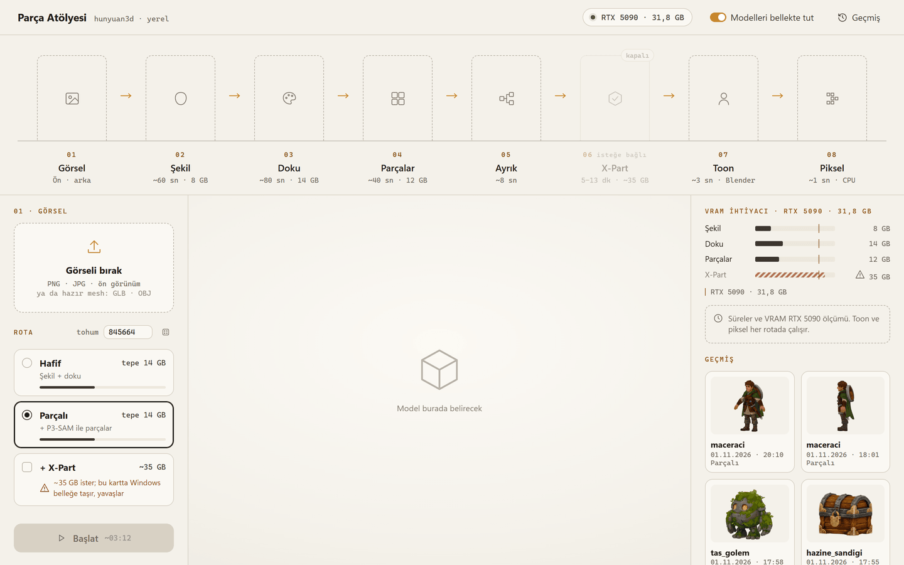
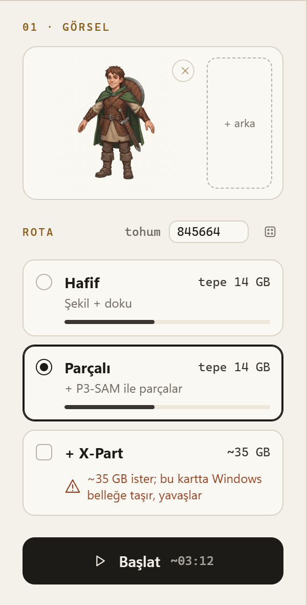
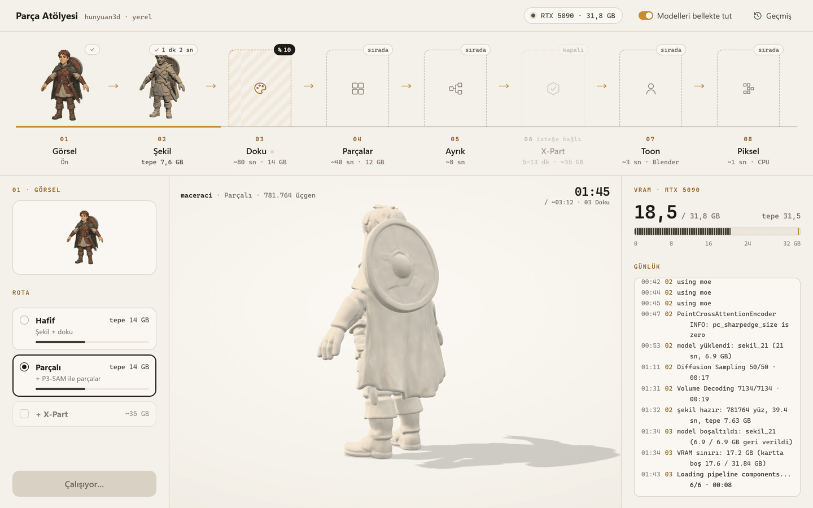
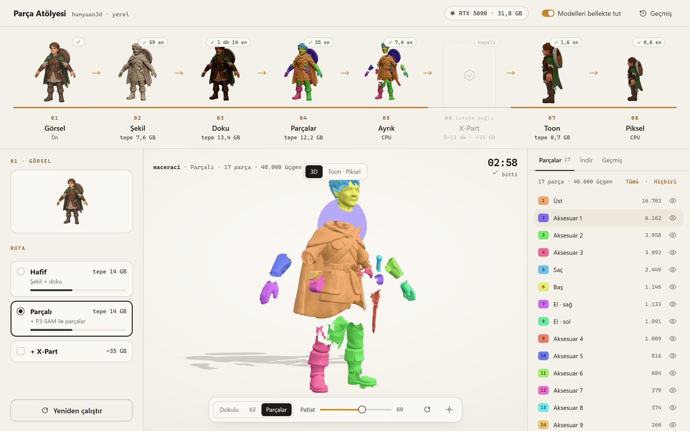
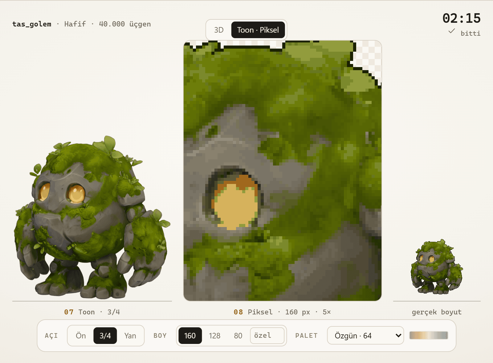
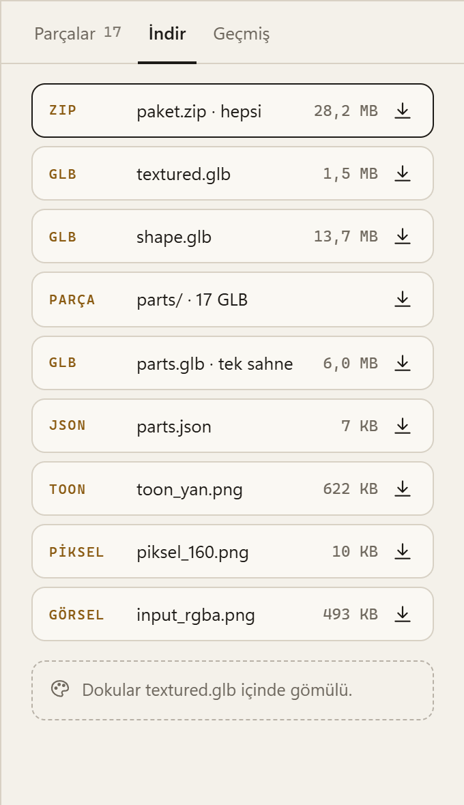
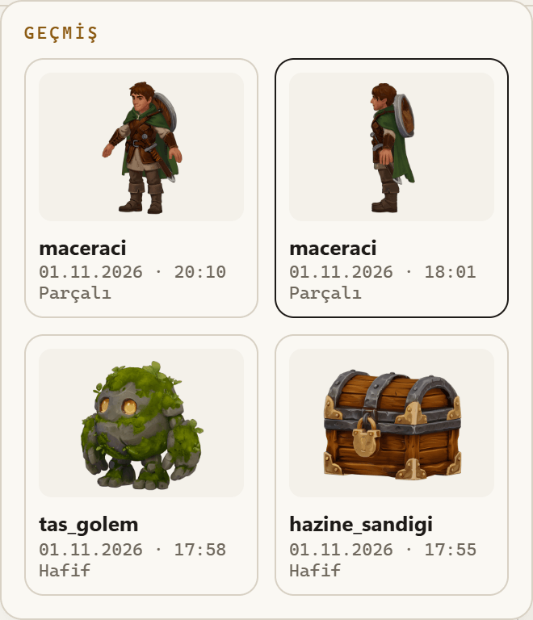

# Paneli kullanmak

Sunucuyu `baslat.ps1` ile başlattıktan sonra tarayıcıda **<http://127.0.0.1:8731>** adresini aç. Panel
internete çıkmaz. Her şey kendi bilgisayarında çalışır.



Ekran üç sütun ve üstte bir şeritten oluşur:

```
┌──────────────────────────────────────────────────────────────────────────┐
│ Parça Atölyesi · GPU adı · VRAM                                Geçmiş     │
├──────────────────────────────────────────────────────────────────────────┤
│ 01 Görsel │ 02 Şekil │ 03 Doku │ 04 Parçalar │ 05 Ayrık │ 06 │ 07 │ 08   │  ← şerit
├──────────────┬───────────────────────────────────┬───────────────────────┤
│ Görsel       │ 3D görünüm  /  Toon · Piksel      │ VRAM                  │
│ Rota         │                                   │ Günlük                │
│ Tohum        │                                   │ Parçalar · İndir      │
│ [ Başlat ]   │                                   │ Geçmiş                │
└──────────────┴───────────────────────────────────┴───────────────────────┘
```

## 1. Görseli bırak

Sol üstteki alana bir **PNG, JPG ya da WEBP** sürükle ya da tıklayıp seç. İlk deneme için
`ornekler\maceraci.png` iyi bir başlangıç.

- **+ arka:** karakterin arkadan çizimi varsa buradan ekle. Şekil iki görselden üretilir (Hunyuan3D-2mv
  gerekir; inmemişse düğme kapalı görünür).
- **Hazır mesh:** görsel yerine **GLB, OBJ, PLY ya da STL** de bırakabilirsin. O zaman şekil adımı atlanır.
  Hafif rotada yalnız toon ve piksel çalışır, GPU modeli gerekmez. Parçalı rotada mesh P3-SAM ile parçalanır.

## 2. Rotayı seç

- **Hafif:** şekil + doku, sonra toon + piksel. Tepe ~14 GB.
- **Parçalı:** Hafif'e ek olarak P3-SAM ile parçalar ve her parça için ayrı GLB. Tepe yine ~14 GB.
- **+ X-Part:** yalnız Parçalı rotada açılır, her kartta seçilebilir. Kapalı, temiz parça meshleri: 40 GB ve
  üstü kartta ~5–7 dakika. Daha küçük kartta "~35 GB ister; bu kartta Windows belleğe taşır, yavaşlar" uyarısı
  çıkar ve Başlat onay ister (32 GB'ta ~13 dakika).
- **Doku** kutusu: yalnız 14 GB'tan küçük kartlarda görünür ve kapalı gelir. Kapalıyken yalnız şekil üretilir.

Panel kartının belleğini okur. Çalışamayacak bir rotayı kilit simgesiyle gösterir ve nedenini yazar ("NVIDIA
ekran kartı bulunamadı", "P3-SAM modeli indirilmemiş" gibi). Sınırda
olan rotada da bir uyarı çıkar. Ayrıntı: [rotalar-ve-vram.md](rotalar-ve-vram.md).



## 3. Tohum ve Başlat

- **Tohum:** aynı görsel ve aynı tohum aynı şekli verir. Zar düğmesi yeni bir tohum seçer. Sonuç beğenmediğin
  bir şekil çıkarırsa önce tohumu değiştir.
- **Başlat** (ya da **Ctrl+Enter**). Düğmenin yanında RTX 5090'a göre tahmini süre yazar.

Bir iş çalışırken ikinci bir iş başlatırsan sıraya girer. Ekran kartında aynı anda tek iş çalışır.

## 4. Çalışırken



- **Şerit:** her adım sırayla dolar. Biten adımın kartında çıktısının küçük resmi, süresi ve tepe VRAM'i
  görünür. Atlanan adımın üzerine gelince nedenini yazar ("Bu rotada yok", "Seçilmedi", "Hazır mesh verildi").
- **Orta:** adımlar bittikçe model gelir. Önce şekil, sonra dokulu hali, sonra renklenip yerine oturan parçalar.
- **Sağ:** canlı VRAM (yarım saniyede bir), tepe işareti ve **Günlük** (modellerin kendi çıktısı dahil). Bir
  şey ters giderse ilk bakılacak yer günlük.

Sayfayı yenilesen ya da kapatıp açsan da iş sürer. Adres çubuğundaki `#is=...` sayesinde aynı iş geri açılır.

## 5. Sonuç: 3D görünüm

- **Fareyle döndür,** tekerlekle yaklaş. Sıfırla düğmesi görünümü başa alır.
- **Dokulu · Kil · Parçalar:** dokulu hali, dokusuz şekli ya da her parçayı ayrı renkte gösterir.
- **Patlat:** kaydırıcıyla parçaları merkezden dışarı açar. Parçaların nerede birleştiğini görmek için birebir.



Sağdaki **Parçalar** sekmesi her parçayı listeler: göster/gizle, üzerine gelince vurgula, tıklayınca seç.
Parçanın yanındaki ad, kaba bir tahmindir (`hair`, `top`, `accessory` …). Bkz.
[adim-adim.md](adim-adim.md#05--ayrık-yalnız-parçalı-rota).

## 6. Toon · Piksel

İş bitince ortada **Toon · Piksel** sekmesi açılır.



- Solda toon render, ortada **5× büyüteç** (sürükleyerek gezdirebilirsin), sağda sprite gerçek boyutunda.
- **Açı:** Ön · 3/4 · Yan. Değiştirince Blender yeniden çizer (birkaç saniye) ve sprite da yenilenir.
- **Boy:** 160 · 128 · 80 ya da 16–512 arası özel bir değer.
- **Palet:** görselden (Özgün 64 / 32 / 16) ya da hazır paletler (`endesga-32`, `pico-8`, `sweetie-16`,
  `gameboy-4`). Her paletin renkleri küçük bir şeritte görünür.

Bunlar GPU adımlarını yeniden çalıştırmaz. İstediğin kadar dene.

## 7. İndir

Sağdaki **İndir** sekmesi bu işin dosyalarını boyutlarıyla listeler: `textured.glb`, `shape.glb`, parçalar,
`parts.json`, toon görselleri, sprite'lar. En üstte hepsi bir arada **paket.zip.** Aynı dosyalar diskte
`cikti\<iş-kimliği>\` klasöründe de durur.



## 8. Geçmiş

Sağ üstteki **Geçmiş** önceki işleri kapak resmi, tarihi, rotası ve parça sayısıyla listeler. Bir işe tıklayınca
bütün sonuçlarıyla geri açılır. Toon ve piksel ayarlarını orada da değiştirebilirsin. Silme düğmesi işi
klasörüyle birlikte siler (onay sorar).



## Klavye

- **Ctrl+Enter:** Başlat.
- **Enter / Boşluk:** odaktaki görsel alanını, rota kartını ya da geçmiş kartını seçer.
- **Esc:** Geçmiş penceresini kapatır.

## Modelleri bellekte tut

Panelin üstündeki **Modelleri bellekte tut** anahtarı açıkken (varsayılan) atölye yüklediği modelleri işler
arasında ekran kartında tutar. İkinci iş model yükleme süresini atlar: RTX 5090'da Hafif rota 150 sn yerine ~90 sn.
Şeritte bu adımların rozetinde "bellekte" yazar. Anahtarın üstüne gelince şu an bellekte olan modeller ve
boyutları görünür (Şekil ~6,9 GB, Doku ~6,6 GB, P3-SAM ~0,4 GB). Kart başka bir adım için yetmezse atölye en uzun
süredir kullanılmayan modeli kendisi boşaltır. Kapatırsan her model, işin onu kullanan son adımından sonra
bellekten çıkar; ekran kartını oyun ya da başka bir iş için boş tutmak istiyorsan kapat.

## Panelin üstünde ne yazıyor?

| Yazı | Anlamı | Ne yapmalı |
|---|---|---|
| **Sunucu yok** | Panel sunucuya ulaşamıyor | `baslat.ps1` penceresi açık mı bak. Sayfa 3 saniyede bir yeniden dener |
| **Kurulum tamamlanmamış** | Python ortamı, kod ya da eklentiler eksik | `kurulum\kur.ps1 ortam` |
| **… modeli indirilmemiş** | O rotanın modeli eksik | `kurulum\kur.ps1 indir` (yarım kalanı tamamlar) |
| **Blender yok** (07'de) | Blender bulunamadı | `atolye.toml` içinde `blender` yolunu düzelt, sunucuyu yeniden başlat |
| **NVIDIA ekran kartı bulunamadı** | GPU görünmüyor | Sürücüyü kontrol et (`nvidia-smi`). Hazır mesh ile Hafif rota yine çalışır |
